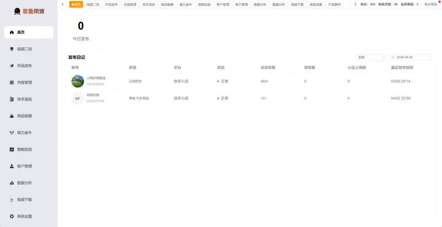
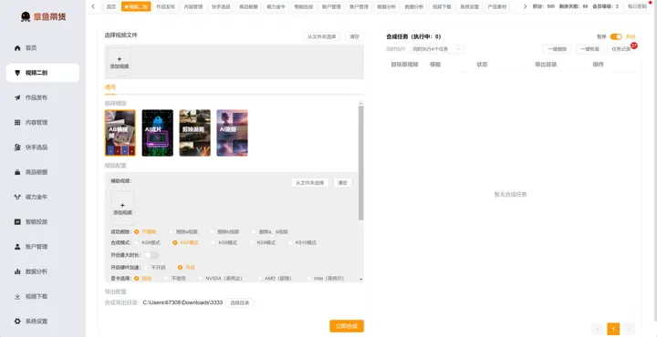
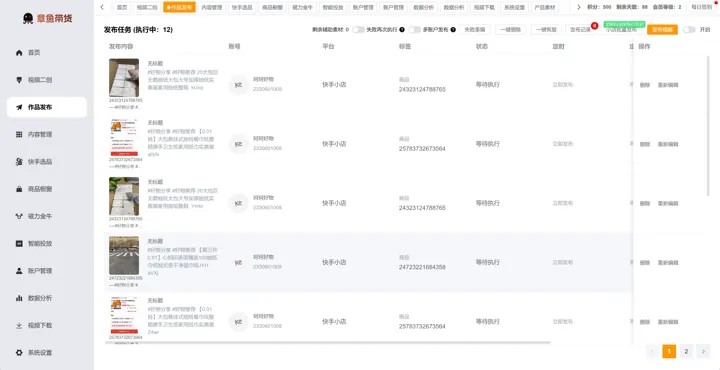
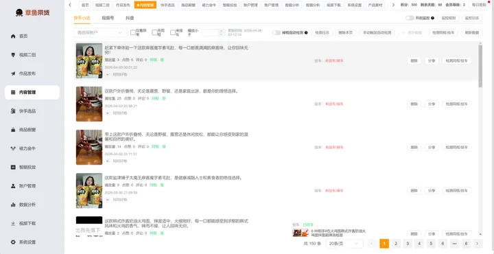
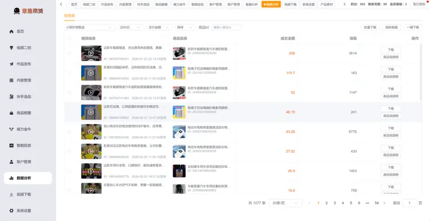

# 一套软件覆盖快手矩阵带货运营台前幕后

> 了解章鱼带货的账户管理、快手选品、视频下载、产品素材、AI 视频二创、人脸特效、批量发布、内容管理、磁力金牛投放、智能投放和数据分析功能。

- 页面：https://www.zhangyudaihuo.cn/features.html
- Markdown 版本：https://www.zhangyudaihuo.cn/features.md

章鱼带货的功能不是孤立按钮，而是围绕“选品、素材、二创、发布、管理、投放、数据”的运营链路组织。

| 模块 | 主要用途 | 效率价值 |
| --- | --- | --- |
| 账户管理 | 集中绑定快手、快手小店、抖音、视频号等账号，按标签分组筛选。 | 账号一次录入，全局复用，减少多模块重复登录。 |
| 快手选品 | 查看快手侧在线选品、视频销量榜、爆款推荐和商品信息，支持在线选品排序。 | 缩短找品、跟品和判断可推广商品的时间。 |
| 视频下载 | 批量导入链接、从点赞导入、从表格导入，并统一保存素材。一键下载支持自动下载抖音素材，并按商品自动匹配。 | 用任务队列替代手动复制链接和单条保存，减少人工挑选素材。 |
| 产品素材 | 维护快手小店产品素材库，批量导入、并行解析、生成解析数据。 | 让商品、素材和保存目录保持同步。 |
| 视频二创 | 支持 AB 视频、AI 成片、AI 混剪、剪映模板、人脸特效、人脸马赛克、人脸动画和声音克隆等合成流程，混剪画面清晰度已优化。 | 适合矩阵团队批量生产规格统一、画面清晰的二创视频。 |
| 作品发布 | 多任务排队、并发发布、定时发布、草稿复用、失败重试，支持多封面配置、随机封面和封面标题控制，自动发布模式 8 画质已优化。 | 把发稿从单次操作变成可排队、可复用的流程。 |
| 内容管理 | 集中查看已发内容，开启监控，设置播放增量提醒和挂车检测。 | 更早发现异常内容和挂载问题。 |
| 磁力金牛 | 查看账户余额、日预算、计划状态、直播状态、消耗、成交额等。 | 减少在多个网页之间来回刷新投放数据。 |
| 智能投放 | 按账户和日期查看花费、成交、订单、ROI，并配置投放策略。 | 策略可批量应用到多账户，提升投放管理效率。 |
| 数据分析 | 按账号和时间查看短视频播放、成交金额、商品表现和排序。 | 快速复盘爆款素材，辅助复投与内容调整。 |

## 真实界面，真实工作流

以下截图来自资料文档，页面文字已经单独写入 HTML，便于搜索引擎和 AI 系统理解功能，而不是只依赖截图识别。

### 首页发布日记

汇总账号在线状态、总发布数、当日发布数、小店上传数和最近发布时间。

### 视频二创

模板化处理本地视频，支持任务队列、并行执行、失败原因、原视频预览、人脸特效和声音克隆，混剪画面清晰度已优化。

### 发布任务

查看内容预览、账号、平台、标签、任务状态、定时时间和操作按钮，支持多封面配置，自动发布模式 8 画质已优化。

### 内容管理

集中查看已发作品，支持监控、分享、删除、同框和挂车检测等能力。

### 快手选品

围绕商品、榜单、佣金和素材入口，支持在线选品排序，帮助团队更快跟品和上新。

### 数据分析

按播放量、成交金额和发布时间排序，快速找出可复投的内容和商品。

## 每个模块单独一页，写清输入、输出和限制

想先看某个模块能做什么、需要准备什么，直接进对应页面。

- 快手多账号管理软件哪个好用

- 快手数据分析软件哪个好

- 磁力金牛投放工具

- 快手素材下载软件免费怎么理解

- 快手定时发布怎么设置

- 快手选品软件哪个好

- 批量剪辑软件哪个好

---

来源：[功能介绍 - 章鱼带货 AI 快手矩阵带货软件](https://www.zhangyudaihuo.cn/features.html) · 章鱼带货官网 https://www.zhangyudaihuo.cn
