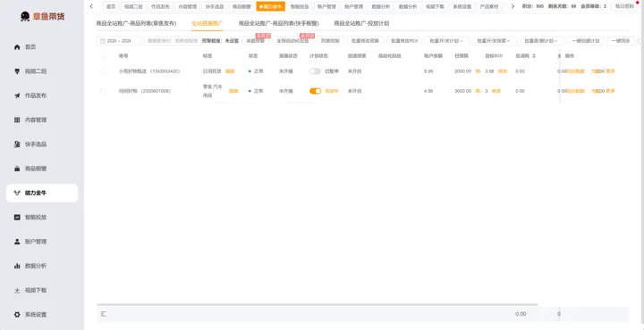

# 磁力金牛投放工具要看的三件事：余额、计划状态、投入产出比能不能在一屏看到

> 磁力金牛投放工具该看什么？余额、日预算、计划状态、消耗、成交额、订单量和 ROI 能不能在一屏看到，看完能不能批量调策略。这一页讲清章鱼带货的磁力金牛与智能投放能做什么、边界在哪。

- 页面：https://www.zhangyudaihuo.cn/features/magnetic-gold.html
- Markdown 版本：https://www.zhangyudaihuo.cn/features/magnetic-gold.md

投手每天真正花时间的不是「改出价」，而是「确认现在什么状态」：余额够不够、计划有没有停、昨天花的钱换回了多少成交。这一页讲清章鱼带货的两个投放相关模块——磁力金牛和智能投放——分别看什么、能改什么，以及哪些事它做不了、资料里也没写。

| 项目 | 说明 |
| --- | --- |
| 能做什么 | 磁力金牛模块集中查看账户余额、日预算、计划状态、直播状态、消耗、成交额、订单量和 ROI；智能投放按账户和日期查看花费、成交、订单和投入产出比，并把投放策略批量应用到多个账户。 |
| 输入 | 已绑定的投放账户、要查的日期范围、要套用的投放策略。 |
| 输出 | 一屏可读的账户与计划状态、按账户和日期汇总的投放数据，以及被批量应用了策略的账户列表。 |
| 限制 | 数据来自平台侧账户，刷新有延迟；能不能代你创建计划、改出价，资料只写到「策略批量应用」，没有写能替代平台后台的全部操作。 |
| 失败提示 | 一键 ROI 修改失败在 v1.4.28 修过，计划创建失败在 v1.4.27 优化过。遇到改不动的情况，先确认版本，再看账户权限和余额。 |

## 为什么要把投放数据收到软件里看

因为分散本身就是成本。账户余额在一个页面、计划状态在另一个、消耗和成交在第三个、订单和 ROI 又要回到报表里对一遍，投手一天的大部分动作其实是「切页面 + 刷新 + 记住上一个数字」。

资料里对这个模块的定位写得很直白：减少在多个网页之间来回刷新投放数据。注意它说的是「刷新」，不是「决策」。工具省的是搬运和对照的力气，判断仍然在人这边。

这件事对矩阵团队尤其明显。一个账户的时候，记住三个数字不难；十个账户的时候，你需要的是同一屏、同一口径、同一时间点的对照，否则两个账户的「ROI 1.8」可能根本不是一回事。

## 磁力金牛模块能看到哪些数据

按资料里的清单，它集中在这些指标上，都是投手每天要确认的状态类数据：

- 账户余额：还够不够投，避免计划跑到一半停掉。

- 日预算：当天设了多少，跟实际消耗对不对得上。

- 计划状态：哪些在跑、哪些被停、哪些没启动。

- 直播状态：和直播相关的投放，先确认直播是不是在进行。

- 消耗：已经花出去多少。

- 成交额与订单量：花出去的钱换回了什么。

- ROI：投入产出比，用来横向比较账户和计划。

这些数字放在一起的价值，是让你在一屏里判断「要不要动」。缺余额就充值，计划停了就查原因，消耗高但成交低就该收。如果它们分散在三个页面，你很难在同一时刻做完这个判断。

### 磁力金牛

余额、日预算、计划状态、直播状态、消耗与成交在同一屏。

### 按账户看

多个投放账户并排，避免来回切换后台。

### 按日期比

智能投放支持按账户和日期看花费、成交、订单和投入产出比。

## 看完数据之后，能改什么

这一块要分成「看」和「改」两层，因为资料对这两层的描述力度不一样。

看的一层比较清楚：智能投放按账户和日期查看花费、成交额、订单量和投入产出比，用来判断哪个账户该加、哪个计划该收。

改的一层是「批量应用投放策略」：策略配好之后能一次套到多个账户上，这正是矩阵团队最需要的——十个小账户手动改一遍出价，光是对照就够呛。资料里还提到过「一键 ROI 修改」这个能力（v1.4.28 修过它的失败问题），以及「计划创建失败」的优化（v1.4.27），说明创建计划和改 ROI 这两类操作是在软件里做的。

但边界也很清楚：它做的是「把平台的投放操作批量化和集中化」，不是「替你决定投多少」。出价、预算、素材组合这些判断，仍然靠人。任何声称能保证 ROI 的说法，都不在这套工具的能力范围内，资料里也没有这样的承诺。

一个实操建议：先用两三个账户验证「批量应用」的结果和你在平台后台手动改的结果是否一致。批量操作最怕的是你以为改了十个，实际只改成了八个。

## 它做不了什么，以及资料里没写的

- 不做投放代运营：工具不替你规划预算、不保证消耗节奏，也不承诺 ROI。

- 不替代平台规则：章鱼带货不是快手官方产品，投放审核、账户权限、违规处理都以平台为准。

- 不保证数据实时：账户数据要在平台侧生成后再同步，看到的是某一时刻的快照。

另外，磁力金牛这个模块和作品发布是联动的：发布环节的挂车失败在 v1.4.38 做过优化，v1.4.25 修过小店橱窗加入失败。投放跑得再好，商品挂不上车，成交也无从谈起。所以看投放数据之前，先确认挂车是正常的。

## 常见问题

### 磁力金牛投放工具能做什么？

集中查看账户余额、日预算、计划状态、直播状态、消耗、成交额、订单量和 ROI，减少在多个后台之间来回刷新；配合智能投放还能把策略批量应用到多个账户。

### 数据是实时的吗？

看到的是平台侧生成后的快照，刚改完的出价不一定立刻反映在消耗上。所以对比时先对齐时间点：同一个时间范围内的两个账户，才比得出差异。

### 能在软件里直接改出价、建计划吗？

资料提到过「投放策略批量应用」「一键 ROI 修改」和「计划创建失败」的修复，说明这类操作在软件内有入口。

### 批量改策略会不会改错账户？

策略是按账户应用的，应用范围由你选。建议先在两三个账户上验证结果与平台后台一致，再扩大到全部——批量操作最怕的不是改错，而是改完不知道改成了什么样。

### 投放和发布是分开的模块吗？

是。磁力金牛与智能投放管投放数据与策略，作品发布管发稿和挂车。两边的数据不在同一张表里，但业务上要一起看。

### 先核对口径，再谈批量

拿两个账户，把软件里的消耗、成交额和 ROI 与平台后台逐个对一遍。数字对得上，再用批量策略；对不上，先查时间范围和数据延迟，不要急着改。

### 获取 Windows 安装包

安装包直链维护中，可进下载说明页看环境要求，或直接联系微信 aff22g 免费申请账号。

联系微信获取安装包

看投放数据复盘

查看全部功能

---

来源：[磁力金牛投放工具 - 章鱼带货投放与智能投放功能说明](https://www.zhangyudaihuo.cn/features/magnetic-gold.html) · 章鱼带货官网 https://www.zhangyudaihuo.cn
