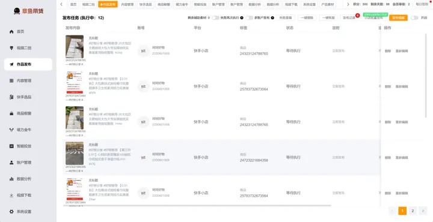

# 快手定时发布怎么设置：把发稿变成队列，而不是整天守着钟点

> 快手定时发布怎么设置？关键不是定个时间，而是让发稿变成可排队、可复用、失败可重试的流程。这一页讲清章鱼带货的作品发布能做什么、输入输出、限制和失败提示。

- 页面：https://www.zhangyudaihuo.cn/features/publish.html
- Markdown 版本：https://www.zhangyudaihuo.cn/features/publish.md

「快手定时发布怎么设置」和「一键分发多平台怎么弄」这两句搜索，背后是同一个痛点：稿子做完了，发的时候还得一条条手动传、到点守着发、发失败了不知道失败在哪。这一页讲清章鱼带货的作品发布能做什么、定时到底定的是什么、失败在哪看，以及跨平台分发这件事资料里能确认到哪一步。

| 项目 | 说明 |
| --- | --- |
| 能做什么 | 多任务排队、并发发布、定时发布、草稿复用、失败重试；支持多封面配置、随机封面和封面标题控制，自动发布模式 8 的画质已优化。 |
| 输入 | 成片（来自视频二创或本地）、要发的账号、平台、标签、封面、话题，以及每条任务的定时时间和模式。 |
| 输出 | 一条条任务记录：内容预览、账号、平台、标签、任务状态、定时时间和操作按钮，失败的可重试，成功的可在内容管理里继续监控。 |
| 限制 | 定时依赖平台侧可发布状态，账号掉线或平台风控都会让任务失败；能不能一条内容同时发到多个平台，资料只写到账号支持多平台，没有写分发矩阵。 |
| 失败提示 | 最常见的是挂车失败和小店橱窗加入失败：挂车问题在 v1.4.38 做过优化，橱窗加入失败在 v1.4.25 修过。任务状态能看出是哪一类，重试前先确认商品和小店状态。 |

## 「定时发布」定的到底是什么

很多人以为定时就是软件到点替你点一下发布。实际要看两件事：任务存不存在，以及到点那一刻账号是什么状态。

任务存不存在，指的是每条内容是不是变成一条带定时时间的队列记录。资料里发布任务的列表明确包含内容预览、账号、平台、标签、任务状态、定时时间和操作按钮——这说明定时是任务的一个字段，不是一次性的动作。好处是你能提前把一周的稿排进去，随时改时间、改封面、停下来。

账号状态则决定了到点能不能发出去。定时到点后，软件要去对应平台执行发布，这一步会受登录状态、平台风控、商品状态影响。所以「设置好了就万事大吉」是不成立的：定时是排期，不是保险。

也因此，判断一套发布工具好不好，不只看它能不能定时，还要看它失败之后你能不能知道为什么。

## 章鱼带货的作品发布，具体提供了哪些能力

按资料里的描述，这个模块围绕「把发稿变成流程」提供了六类能力：

- 多任务队列与并发：一次排多条，按队列走，不用一条条等。

- 定时发布：每条任务带定时时间，可以提前铺排。

- 草稿复用：发过的配置能复用，减少重复填写。

- 失败重试：任务失败可以重来一次，不必重新做整条。

- 封面控制：多封面配置、随机封面、封面标题控制，v1.4.43 加进来的。

- 画质优化：自动发布模式 8 的画质在 v1.4.43 做过优化。

这六条里，真正省时间的是「草稿复用 + 失败重试」这一对。矩阵发稿的日常不是一次发十条，而是同一套配置换个成片再来一遍：封面怎么设、话题怎么带、标签怎么打。草稿复用把这些固定下来，失败重试则保证偶发失败不会让你从头再来。

### 发布任务

内容预览、账号、平台、标签、任务状态、定时时间和操作按钮在同一行。

### 定时与排队

任务带定时时间，可并发执行，也可以先排着。

### 多封面

多封面配置、随机封面、封面标题可控，v1.4.43 起。

## 「一键分发多平台怎么弄」：账号怎么放，任务怎么发

这句话要拆成两层：账号怎么放，任务怎么发。

能确认的一半是账号侧：账户管理支持集中绑定快手、快手小店、抖音、视频号等账号，发布任务里也有「平台」这一列。也就是说，一条任务对应哪个平台是明确的，不同平台的账号在同一个池子里。

第二层是「一键」这件事本身。一条内容要在一次操作里同时投到多个平台，中间隔着字段差异：标题长度、话题格式、封面比例，每个平台都不一样。所以更稳的做法不是指望一次点击，而是把同一份成片按平台拆成几条任务。

具体做法是：把「多平台」当成「多个账号分别在同一个队列里发」。同一个成片，按平台建几条任务、各自设置封面和话题，仍然走同一套队列和重试逻辑。这样即使一键分发不支持，你的流程也没被卡住。

## 发不出去的时候，按这个顺序查

发布失败的信息量其实很大，关键是别从错的地方开始查。

- 先看任务状态：确认是排队没轮到、执行失败，还是已经发出但挂车没成功。三种原因的修法完全不同。

- 再看商品与小店：挂车失败、橱窗加入失败都属于这一类。v1.4.38 优化过挂车失败，v1.4.25 修过小店橱窗加入失败，先确认版本够新。

- 然后看账号：账号掉线、被平台限制，会在执行阶段直接失败。这类失败重试也没用，得先把账号恢复。

- 最后看内容本身：封面尺寸、话题格式、标题长度不合平台要求，也会被拦。

发布之后还有一段：内容管理支持集中查看已发作品，可以开监控、设置播放增量提醒、做挂车检测。也就是说，发出去不等于结束，挂没挂上车、播放有没有异常，是下一屏的事。

两条边界提前说清。第一，章鱼带货不是快手官方产品，发布频率、内容合规、账号行为都以平台规则为准，工具不替你承担违规后果。第二，资料里的安装包是 Windows x64，推荐 Windows 10 或 Windows 11、Chrome 129 到 136，具体以软件内提示为准——定时任务要跑，机器和浏览器得先稳。

## 常见问题

### 快手定时发布怎么设置？

在发布任务里给每条任务设定时时间，任务会进队列，到点执行。列表里能看到定时时间和任务状态，也能随时调整。

### 定时到点没发出去，会怎样？

任务会停在失败状态，可以重试。失败原因要看任务状态和商品/账号状态——先分清是排队没轮到、执行失败，还是发出去但挂车没成功。

### 能一条内容同时发到多个平台吗？

账号管理支持多平台账号，发布任务里每条都有平台字段，落点是明确的。跨平台发布建议按平台各建一条任务，封面和话题分别设置，仍走同一套队列和重试逻辑。

### 一次能排多少条任务？

支持多任务队列和并发发布。实际能排多少条取决于机器配置和账号状态，建议先用十几条压一轮，看队列消化速度再定日常节奏。

### 封面能不一样吗？

可以。v1.4.43 起支持多封面配置、随机封面和封面标题控制，同一批任务可以用不同封面。

### 发出去之后还能管吗？

能。内容管理里可以集中查看已发作品，支持监控、分享、删除、同框和挂车检测，还能设置播放增量提醒。

### 先排一天的稿，看队列跑不跑得顺

建议先用一个账号、十条成片试：设三个不同时间点，故意留一条失败（比如商品没上架），看你能不能从任务状态里一眼定位。这一步过了，再加账号和平台。

### 获取 Windows 安装包

安装包直链维护中，可进下载说明页看环境要求，或直接联系微信 aff22g 免费申请账号。

联系微信获取安装包

查看更新日志

看批量发布实践

---

来源：[快手定时发布怎么设置 - 章鱼带货作品发布功能说明](https://www.zhangyudaihuo.cn/features/publish.html) · 章鱼带货官网 https://www.zhangyudaihuo.cn
