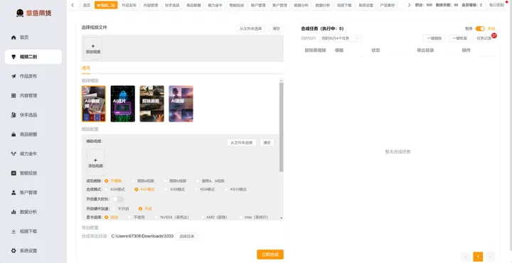
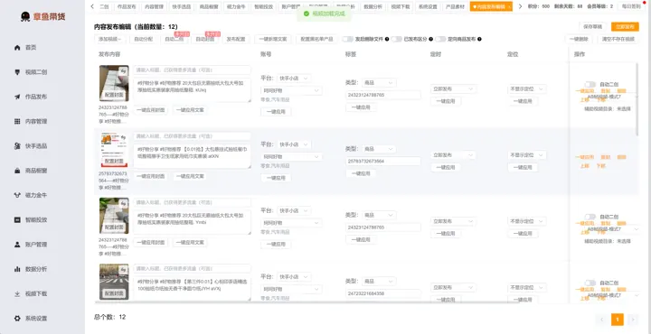
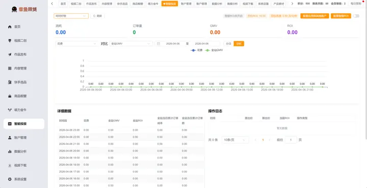

# 章鱼带货，跑通 快手矩阵带货全流程

> 章鱼带货是一款面向快手矩阵带货团队的 AI 短视频带货软件，覆盖账户管理、快手选品、素材下载、视频二创、批量发布、内容管理、磁力金牛投放和数据分析。

- 页面：https://www.zhangyudaihuo.cn/index.html
- Markdown 版本：https://www.zhangyudaihuo.cn/index.md

把账户管理、快手选品、素材下载、视频二创、批量发布、内容管理、磁力金牛投放和数据复盘整合到一套工作台里，减少多网页、多工具之间的反复切换。

## 软件版本和功能更新记录

这里只放章鱼带货软件本身的版本变化、功能调整、安装包说明和运行环境要求，方便用户判断是否需要更新或重新获取安装包。

2026-08-05

### 当前版本：Windows x64 v1.5.39

发现新版本 v1.5.39，请下载安装后再运行。本次新增：豆包登录支持浏览器登录。

2026-08-05

### 封面与发布画质调整

新增多封面配置，可随机封面并自由控制封面标题；自动发布模式 8 的画质也做了优化。

查看完整更新日志

## 短视频带货不是单点工具问题，而是一条链路的效率问题

选什么品、素材从哪里来、视频怎么批量二创、账号怎么分组发布、投放怎么看 ROI、爆款怎么复盘，任何一个环节卡住，都会拖慢整个矩阵。

### 选品分散

榜单、佣金、商品信息和可推广素材分散在不同页面，团队容易靠经验和手抄表推进。

### 素材产能低

批量下载、AB 视频、AI 成片、AI 混剪、剪映模板都需要标准化，否则账号越多越难稳定产出。

### 发布难规模化

多账号发布、定时发布、失败重试、草稿复用，如果靠人工逐条操作，很难形成固定节奏。

### 投放复盘慢

磁力金牛数据、计划状态、日预算、ROI 和成交表现需要集中查看，才能更快调整策略。

## 章鱼带货覆盖快手矩阵带货主流程

软件按运营顺序组织功能，让团队可以从账户、商品、素材、内容、发布、投放和数据复盘一路推进。

01

### 账户管理

集中绑定抖音、视频号、快手、快手小店等账号，支持标签分组和批量导入。

02

### 快手选品

围绕快手带货查看商品、榜单和爆款推荐，缩短找品与决策时间。

03

### 素材准备

通过视频下载、产品素材库和保存目录统一管理素材，减少文件混乱。

04

### 视频二创

支持 AB 视频、AI 成片、AI 混剪、剪映模板等二创方式，适合矩阵批量生产。

05

### 发布复盘

批量发布、内容管理、智能投放和数据分析共同形成发布与复盘闭环。

## 把重复操作交给流程，让团队专注判断

查看全部功能

### AI 视频二创

从文件夹添加素材，选择 AB 视频、AI 成片、AI 混剪或剪映模板，统一查看合成任务进度。

### 批量发布

支持多账号、多任务、草稿复用、定时发布、封面和话题配置，让发稿流程更可控。

### 智能投放

集中查看花费、成交额、订单量和投入产出比，并把投放策略批量应用到多个账户。

## 下载软件，申请账号，按教程跑第一条链路

建议使用 Windows 10 或 Windows 11。安装后在系统设置里配置 Chrome 路径、缓存、代理和 AI 相关参数，再进入账户管理绑定账号。

- 安装包当前资料版本：Windows x64 v1.5.39。

- 推荐 Chrome 版本：129-136，具体以软件内提示为准。

- 账号申请与服务支持：微信 aff22g。

- 章鱼带货不是快手官方产品，平台规则、授权方式和功能位置请以实际页面为准。

### Windows 安装包

安装包链接维护中，可先进入下载说明页，或联系微信 aff22g 获取最新版安装包。

获取安装包

联系微信 aff22g

查看安装说明

---

来源：[章鱼带货 - AI 快手矩阵带货软件官网](https://www.zhangyudaihuo.cn/index.html) · 章鱼带货官网 https://www.zhangyudaihuo.cn
